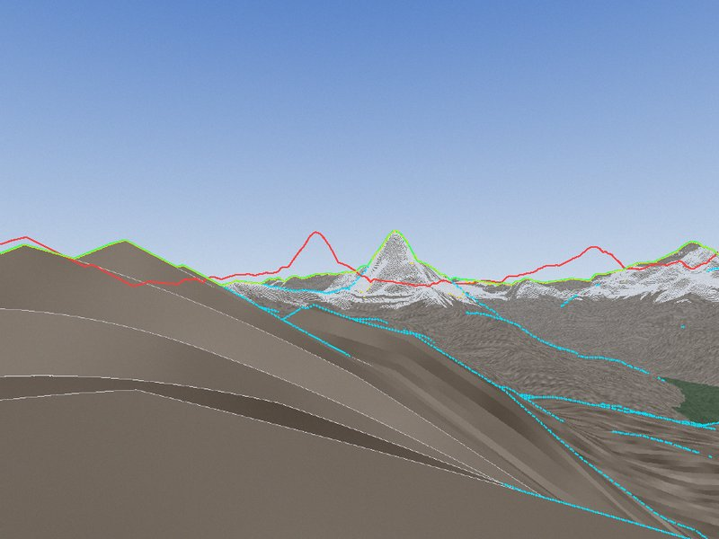
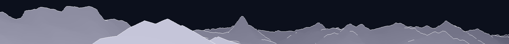

# Peak

An iPhone app that labels the mountains in your camera view and stays lined up with them. Phone compasses are often 5–15° off, which is why other peak apps drift. Peak corrects the heading by matching the skyline the camera sees against the skyline the terrain says should be there.

This repo holds the skyline matching from the [project brief](CLAUDE.md), built and measured at a desk first, and the iPhone app (0.8) that uses it in a live camera view, with peak details and hikes.

For development, see the shared [agent guidance](AGENTS.md) and [Codex/Claude peer collaboration workflow](.agents/skills/peer-collaboration/SKILL.md).



*Red is where an 8° wrong compass puts the horizon, green is after correction (0.02° off), yellow is the detected skyline, and cyan marks ridges behind it.*

## The app (0.8)

Peak opens straight into the camera. The lines and labels stay on the mountains as you move the phone, the way PeakVisor's do: the phone's motion sensors (gyroscope, accelerometer and compass) give its orientation. Since the mountains are kilometers away, only the phone's rotation matters, so there's no ARKit world tracking to wait for. It works in portrait and landscape.

The first time you use it somewhere, it downloads the terrain and the named peaks for 80 km around you and keeps them, so the same area works offline afterwards. Then it draws:

- the skyline and the ridges in front of it as thin glowing lines, nearer ones brighter and farther ones fading;
- labels (name and height) for the highest peaks you can actually see (6, 10 or 18, in Settings), and a small dot on every other peak in sight. Peaks hidden behind a nearer ridge aren't shown. Peaks OpenStreetMap has no elevation for show the terrain's, marked "≈".

**Pinch** to zoom in on the picture and the lines together, up to 6× (zoomed in past 2×, the camera switches to 4K where the phone can, so the picture stays sharp); more labels fit as the peaks spread apart. Tap the zoom chip at the top to zoom back out.

**See over the ridges.** Hold the arrow button above the right end of the bar and the view rises above where you stand, a step higher every moment while you hold it: 100 m, 300 m, then 1 km (300, 1,000 and 3,000 ft in feet). The camera picture can't come up too, so a night sky takes its place, with the land below the skyline darker and the ridgelines and labels drawn from up there as you turn the phone. Peaks that come into sight only from above get dashed leaders, or open rings instead of dots, and the chip at the top counts them all the way around ("300 m up · 12 more peaks around you"). Let go and it comes back down to the camera (straight back with Reduce Motion); pausing the view, a card or a sheet brings it down too. Each view from above is built on the first press (1.25 s each in a release build on the simulator above Zermatt) and kept until the view around you changes; the live view, skyline matching, the cards and trails stay on the ground throughout. The views reach as far as the terrain Peak loads, 80 km: high up, a skyline at that edge isn't the real one, so it's drawn as faintly as the farthest ridges. The trail on the mountain and the sun path wait on the ground. The button shows once the peaks are in, and not over the coarse base layer or with an approximate location. With VoiceOver, activating it goes up one step and stays there; swipe up or down to change the height, or activate it again to return to the camera.

The overlay costs the main thread about a millisecond a frame: the lines are drawn on the GPU with Metal (each segment an instanced quad, shaded with its line and glow in one pass), and each label is drawn once into an image that is then only moved. Skyline matching and building the view run below the interface's priority. Ridges nearer than 1 km aren't drawn (in town they're mostly houses and trees), and the sharp terrain around you blends into the coarser terrain beyond over its last few pixels, so its edges don't show up as lines.

**Tap a label or a dot** for the peak's card: elevation, prominence, distance, bearing, how far above you it is, its range, first ascent and a Wikipedia summary and picture, and the **hikes nearby**: OpenStreetMap hiking routes and named paths within 8 km of the summit, plus unnamed paths up to it, with length, climb, difficulty on the SAC scale (T1–T6) and how far the start is from you. Those that reach the summit come first. A hike's card has a map of it from above, drawn from the terrain on the phone and faintly tinted where OpenStreetMap maps glaciers, water, bare rock and scree (tap it for the full map: satellite imagery by default while there's a connection, or the terrain, a choice Peak keeps; zoom out to see where you are, or tap the arrow pointing your way; from there **Walk in 3D**, over the same imagery, sharper around the walker and under a daylight sky, or tinted the same way under a night one, with the hike's summit and a few of the most prominent mountains around named, each only while it's in sight from the camera, fading into the haze), an elevation profile and directions to the start. **Show on the mountain** lays the trail on the real slope in the camera view, leaving out the parts hidden behind nearer terrain.

**The ground under trails, in the United States.** Copernicus is a surface model: in a forest its heights take in much of the trees, and at 30 m it rounds off sharp crests and fills narrow gullies. Within 10 km of you (5 km on mobile data unless terrain on mobile data is on), Peak also fetches USGS 3DEP's 10 m bare-earth terrain model and uses it for a hike's climb, descent and profile, what's left to climb while you walk it, the maps from above and the walk in 3D. On the 49 hikes of Mount Le Conte in the Smokies, climbs change by 9 m (median) and up to 36 m, and the lowest point of a hike comes out 19 m lower (median) under the trees. The camera view stays on Copernicus: skylines, ridgelines, labels, what is hidden, skyline matching and the trail drawn on the mountain, all seen from an eye on the same surface. A forested ridge's outline is its treetops, and drawing the trail on the bare ground needs the eye on the ground too: on the Alum Cave Trail, Copernicus puts it 23 m up, and with only the trail moved to the ground it was drawn up to 2.5° too low around you. Moving the eye for the whole view is for a later change, measured on photos. Elsewhere, there is no bare ground and nothing changes.

**Labeled pictures.** Tap the pill to pause the view, then the **share button** beside it: the frame on screen opens full size, turned upright the way you held the phone, with the ridgelines and labels drawn in the picture's own resolution (labels scaled to it, with a soft halo so they read on snow and bright sky) and a small attribution line. Choose **Labels** or **Lines only**, then **save to Photos** (Peak only asks to add pictures, never to see your library) or **share**. Tap a label for the peak's card.

**Label a photo** (Settings) does the same for a photo from your library, through the system photo picker, so Peak sees only the photo you pick. It reads where the photo was taken, which way the camera faced (true or magnetic; a magnetic heading gets the local declination from the IGRF model), the lens and the orientation; downloads the terrain and peaks there if they aren't on the phone; and matches the photo's skyline to correct the compass, pitch and roll. A photo without a heading is matched all the way around, and only counts when no other direction fits about as well. When there's no clear match, drag the lines onto the mountains and turn them with two fingers; **Done** then matches again from there, which snaps the lines onto the skyline when it can.
**The sun, over the real terrain.** A peak's card says when the sun first reaches its summit and when it leaves it today (the last light that makes alpenglow, worked out from the summit's own horizon), and when the sun goes behind the ridge for you, named after the peak it sets behind when there is one. An optional reminder comes 20 minutes before alpenglow on a peak you pick. A hike's card estimates the walking time up and back (DIN 33466), says when the sun leaves the top and the start, and suggests a turnaround time when the hike won't fit in the light left. Times are in the place's own time zone. In Settings, **Today's sun path** dots the sun's path across the sky in the camera view, with hour ticks.

The **list button** (bottom left) lists every peak around you, those in view first, with search; picking one highlights it in the view, with an arrow at the edge when it's out of frame. **Settings** (bottom right): meters or feet, how many labels, ridges, the haptic tick, terrain on mobile data, **offline areas**, and storage.

### Staying lined up

- **Skyline matching.** About once a second, while you hold the phone steady, Peak matches the skyline in the camera picture against the terrain and corrects the compass heading, pitch and roll. The pill at the bottom shows which way you're facing and **Locked** (green, matched within 20 seconds) or **Compass** (orange: point the phone at mountains with a clear skyline and hold it still for a moment).
- **Panning.** A frame with too little skyline to match alone, say through a window or between roofs, is kept for a few seconds and matched together with the next ones as you turn the phone, placed by the gyroscope alone (the compass is often pulled off indoors). See [docs/skyline-stitching.md](docs/skyline-stitching.md).
- **Frame timing.** The app shows the camera frames itself and draws the lines for each frame with the phone's orientation at the moment that frame was taken (motion readings arrive 100 times a second and are interpolated). A camera picture reaches the screen a few hundredths of a second late, so drawing with the latest orientation made the lines run ahead of the picture while turning.
- **Lens.** The field of view and optical center come from each frame's intrinsic matrix when the camera provides one, with focus kept far.
- **Terrain detail.** See below. The shape of a nearby ridge is only as good as the terrain model, and sharp summits get their tips back from the peaks' surveyed heights (see "DEM accuracy at sharp summits").

**Line up by hand** (the arrows button, bottom right) when the skyline can't be matched, say behind trees and roofs: the picture pauses, and you drag the lines onto the mountains and turn them with two fingers to level them. On a paused view, dragging slides the lines left or right along the horizon. Either way the pill then shows **Lined up** (cyan), and skyline matches move the lines again only once two of them agree. The tilt you set lasts for now; the level skyline matches measure is what's saved for your phone, separately for holding it upright and sideways, since a camera mounted a little askew tilts the view differently each way.

Labels stand upright in the world whichever way you hold the phone, even with the screen's rotation locked.

**Tap the pill** to pause the view so you can lower the phone and look; tap it again to go live. **Long-press the pill** for diagnostics (sensor rate, heading, corrections, last skyline match, GPS, terrain detail, lens, frame timing); a screenshot of them says a lot when something looks off. A light tick marks a labeled peak crossing the middle of the screen.

**Downloads:** the Copernicus tiles have lower-resolution copies built in, and the full 30 m image is stored in blocks of about 2.5 MB. Peak starts downloading as soon as it has a rough position, fetching tiles at 240 m (about 0.6 MB each) and 120 m within 30 km (2 MB), all at once, and shows the view as soon as the tile you're in arrives. Then it sharpens the terrain block by block: the full 30 m within 10 km, 60 m within 35 km and 120 m everywhere, then USGS 3DEP's bare ground in the United States (its 512-pixel blocks of about 0.8 MB, 25 MB for all 10 km), and 30 m within 15–25 km on Wi-Fi (or on mobile data, unless you turn that off). Peaks, hikes and land cover come from OpenStreetMap through the Overpass API, facts from Wikidata and Wikipedia. Land cover (`natural=glacier|water|bare_rock|scree`, `waterway=riverbank`) is fetched in 0.1° cells, a block of up to 3 by 3 per query, with each area's whole outline so its rings close, and kept in a compact form (about 80 KB a cell in the Alps, a sixth of the Overpass answer); it's fetched only with a signal, and drawn from what's on the phone without one. Everything is cached on the phone. Overpass searches ask two servers at once (the main one and OpenStreetMap France's) and take the first good answer, then try the others; a server that answers but reports the query ran out of time counts as busy, not as "no hikes". When the peaks can't be fetched (no signal, every server busy) and none are saved for the place, the pill says **Getting peaks…** and Peak tries again, after 10 s and then less often, up to once a minute.

**First launch anywhere, without a signal:** the app bundles a worldwide base layer (`World.pkbase`, 47 MB): coarse terrain for the whole world and every named OpenStreetMap peak (about 700,000). Where nothing is on the phone yet and the terrain doesn't come within a few seconds (at once with no signal), the view is drawn from it, and the pill says **Coarse terrain**; the downloaded tiles replace it as they arrive. Its terrain is good for far skylines, not near ones, so on it Peak stands your eye at the GPS altitude rather than on kilometers of averaged ground, leaves the first 3 km out of the horizon, matches the skyline only where it is at least 20 km away (with wider expected errors), and shows peaks whose line of sight it can't settle (near ones, or ones just clearing a ridge) as dots, never as labeled in sight or hidden. The bundled peaks stand in the same way until OpenStreetMap answers.

**Offline areas** (Settings): before a trip without a signal, pick a place on a map (search for, say, Great Smoky Mountains), choose a radius of 5–50 km and download it. Peak fetches what the view needs anywhere in the circle: 30 m terrain within 10 km of it, 60 m within 35 km, 120 m for everything that can be seen from it (80 km), the peaks in that range, the hikes of every peak in it, and the land cover around those hikes. The hikes are fetched in boxes of up to 30 km, so a large area doesn't run out of time on the server, with the unnamed paths up to every summit, as for a single peak. It shows the size first (about 70 MB for 25 km in the Smokies), the progress while downloading, and resumes a download that stopped, without fetching again what it already has (at launch and when the connection comes back; on mobile data only if terrain on mobile data is on). An area counts as saved only when everything was kept, so a full disk shows as a failure. Inside a saved area the peaks and hikes come from the phone, without waiting on the network; an area that stopped partway still lends what it has. With no signal outside an area, the peaks cached nearest you that reach this far are used. Deleting an area keeps the terrain another area, or the place you are, still uses.

Not in 0.8 yet: a learned skyline detector, and bare-ground terrain outside the United States.

## Installing on your iPhone

You need an iPhone with iOS 17 or later. Both ways work with a free Apple ID; with a free Apple ID the app stops opening after 7 days until you refresh or reinstall it.

### Option 1: Sideload the IPA (no Xcode)

Every push builds an unsigned `Peak.ipa`: open the latest **Build** run under the repo's Actions tab and download the **Peak.ipa** artifact. Tagged versions (`v0.1.0` and so on) also put `Peak_<version>.ipa` on the Releases page.

iPhones can't install an app file directly, so a sideloading tool signs it with your Apple ID:

- **SideStore** installs and refreshes apps from the iPhone itself. Setting it up needs a computer once; follow the guide at [sidestore.io](https://sidestore.io). Then open SideStore, go to **My Apps**, tap **+** and pick the IPA. Open SideStore at least once a week and tap **Refresh All**.
- **Sideloadly** installs from a Mac or Windows PC over a cable: drag the IPA into [Sideloadly](https://sideloadly.io), enter your Apple ID and click **Start**. Do it again within 7 days, or turn on its automatic refresh.

The first time, also turn on **Settings → Privacy & Security → Developer Mode** and restart the iPhone, then trust your Apple ID under **Settings → General → VPN & Device Management**.

### Option 2: Build it in Xcode

On a Mac with Xcode 16 or later, first fetch the worldwide base layer once (47 MB, from a GitHub Release; checked against a pinned SHA-256, and again whenever `Tools/fetch_base_layer.sh` changes):

```bash
sh Tools/fetch_base_layer.sh
```

The app builds without it, but then has no view on first launch without a signal. Then open `Peak.xcodeproj`, select the **Peak** target, set **Signing & Capabilities → Team** to your Apple ID (change the bundle identifier `com.fry19.peak` if Xcode says it's taken), pick your iPhone and press **Run**.

When Peak starts, allow the camera and your location.

## Where it stands

| | |
| --- | --- |
| **Horizon renderer** | Ray-marches the DEM every 0.1° out to 150 km from any point, with the Earth's curvature and atmospheric refraction (k = 0.13). Besides the skyline it keeps a depth map of everything visible below it, so it knows every ridge and how far away each one is. The full 360° takes about 0.4 s on 4 CPU cores. |
| **Skyline detection** | A simple, model-free heuristic for now: it models the sky as a smooth color gradient and the terrain as a mix of colors, then finds the best boundary across the image by dynamic programming. It handles clouds and trees in front of the skyline. It's meant to be replaced by a small Core ML model. |
| **Alignment** | Searches ±20° of heading plus small pitch and roll corrections, then refines with robust least squares. Pitch and roll stay within ±1.5° and ±1° of the motion sensors, for the best fit and every rival it's compared with, so a short or flat skyline can't fit the wrong heading by tilting (a roof's slope taken for a ridge's). Each skyline point counts according to how far away that part of the skyline is: a 15 m GPS error moves a ridge 500 m away by 1.7°, but a ridge 20 km away by only 0.04°. |
| **Gating** | A frame's correction is only used if most of its skyline matches, enough of it is far away, and no other heading fits nearly as well. Otherwise the frame is skipped. |
| **Desk harness** | `peakbench` renders horizons, makes synthetic photos with a known camera, aligns a photo case (your own iPhone photos included), runs Monte Carlo benchmarks (same-DEM and harder), and benchmarks real photos with summits marked in them. |

### Results so far

Heading error after skyline matching, on frames the gates accepted. Each row is 30 photos aimed where the skyline is at least 5 km away, as when someone points the phone at the peaks. The matcher only gets the GPS position (up to 15 m off), a compass heading with ~8° of error (σ), and pitch and roll as ARKit gives them (±0.4°). About half the frames have clouds and some have trees in front.

| Benchmark | Site | median | 90th percentile | worst | accepted |
| --- | --- | --- | --- | --- | --- |
| Compass alone (before matching) | Gornergrat | 7.20° | 12.82° | 13.62° | |
| **Same-DEM synthetic** | Gornergrat | 0.043° | 0.082° | 0.115° | 30 of 30 |
| **Harder synthetic** | Gornergrat | 0.063° | 0.196° | 0.205° | 28 of 30 |
| Harder synthetic, no pitch/roll (photo mode) | Gornergrat | 0.062° | 0.127° | 0.228° | 29 of 30 |
| Harder synthetic | Great Smoky Mountains | 0.058° | 0.216° | 2.665° | 21 of 30 |
| **Real photos** | | *not yet measured* | | | |

- **Same-DEM synthetic** photos are rendered from the very terrain they are matched against, with a perfect pinhole camera. They test the geometry and the matcher, and are the best case. CI's history of this row goes back furthest.
- **Harder synthetic** photos are rendered from a perturbed copy of the terrain (blurred by 0.8 px, height noise within ±5 m, shifted 15 m), and matched against the terrain the app actually holds: 30 m within 10 km, 60 m within 35 km and 120 m beyond, with summits raised to their OpenStreetMap elevations (matching side only, as in the app). The camera has radial lens distortion (|k1| up to 0.005) and rolling shutter (up to 0.3° across the frame). Each condition on its own costs about as much: the different DEM 0.055° median, lens and shutter 0.058°, the app's terrain 0.036–0.046°.
- **Great Smoky Mountains** (Mount Le Conte): rounded, forested ridges to the top, thick haze, much of the skyline far off across low country. More frames are turned away for lack of distant skyline structure, and one frame was accepted 2.7° off: a flat skyline 100 km away, with clouds and trees in front. So the gates can still be fooled there.

The real-photo row stays empty until there are real photos with marked summits (see [Testing with your own photos](#testing-with-your-own-photos)). No competitor publishes a number like it. CI runs all the synthetic rows on every push and posts the tables in the job summary.

### DEM accuracy at sharp summits

The Copernicus 30 m DEM is right for broad mountains but **cuts off sharp summits**. Within 300 m of each summit, the DEM's highest point:

| Summit | Real height | Copernicus | Short by |
| --- | --- | --- | --- |
| Matterhorn | 4,478 m | 4,330 m | 148 m |
| Dom | 4,545 m | 4,472 m | 73 m |
| Weisshorn | 4,506 m | 4,430 m | 76 m |
| Dufourspitze | 4,634 m | 4,536 m | 98 m |
| Mont Blanc (a broad snow dome) | 4,808 m | 4,811 m | — |

From Gornergrat, 10 km away, the Matterhorn's tip should appear about 0.85° higher than the DEM puts it. Robust matching tolerates this, since it's a few columns of the skyline, but it shows up in labels and outlines. Since 0.4 the app raises the terrain around each named summit to a cone (about 45°) reaching the peak's elevation from OpenStreetMap, where the DEM falls 8–300 m short, so skylines and ridgelines get their tips back. National lidar DEMs (swissALTI3D at 2 m in Switzerland, USGS 3DEP in the US) would do better still.

## Trying it

You need Swift 5.9 or later (Xcode 16 on a Mac, or Swift for Linux), and Python 3 to download terrain.

```
pip install -r Tools/requirements.txt
python3 Tools/fetch_dem.py --lat 45.9837 --lon 7.7856 --radius-km 100 --out DEM

cd PeakCore
swift build -c release
.build/release/peakbench horizon --dem ../DEM --lat 45.9837 --lon 7.7856 --image panorama.png
.build/release/peakbench synth --dem ../DEM --lat 45.9837 --lon 7.7856 --heading 262 --compass-error 8 --out matterhorn
.build/release/peakbench align matterhorn.json --dem ../DEM --debug aligned.png
.build/release/peakbench bench --dem ../DEM --lat 45.9837 --lon 7.7856 --runs 30
.build/release/peakbench bench --dem ../DEM --lat 45.9837 --lon 7.7856 --runs 30 --harder --peaks peaks.json
.build/release/peakbench pan --dem ../DEM --lat 45.9837 --lon 7.7856 --runs 30 --gap 4
.build/release/peakbench sun --dem ../DEM --lat 45.9837 --lon 7.7856 --date 2026-10-21 --tz Europe/Zurich \
    --peak-lat 45.9763 --peak-lon 7.6586 --peak-ele 4478
```

`--harder` renders the photos from perturbed terrain, matches against the app's mixed 30/60/120 m terrain (with summits raised to the peaks in `--peaks`, an Overpass answer) and adds lens distortion and rolling shutter; `--world`, `--match` and `--camera` turn these on one at a time. For the second site, fetch `--lat 35.654 --lon -83.444` into another directory and add `--scene smokies`.

`fetch_dem.py` downloads Copernicus GLO-30 tiles from the public AWS bucket (about 40 MB per 1° tile; 8 tiles for 100 km in the Alps) and converts them to `.pkdem` files. `fetch_ground.py` fetches USGS 3DEP's bare ground the way the app does, just the blocks within `--radius-km` (default 10), as one `.pkdem` patch per cell; `peakbench trails … --ground DIR` then compares each hike's climb and its line on the mountain with Copernicus alone:

```
python3 Tools/fetch_ground.py --lat 35.654 --lon -83.444 --out GROUND-smokies
.build/release/peakbench trails hikes.json --lat 35.6543 --lon -83.4361 --dem ../DEM-smokies \
    --ground ../GROUND-smokies --from-lat 35.611 --from-lon -83.425
```
 Use a release build of `peakbench`: debug builds are 10–35× slower. On Linux, images are read and written as `.ppm`.



### Testing with your own photos

Real photos are how the accuracy claim gets measured: `peakbench realbench` runs a directory of them and reports the heading error before and after matching, how many frames were accepted, and why the others were turned away, in the same table format as `bench`.

**Collecting photos.** Either source works, and both can go in the same directory:

- **iPhone Camera photos.** These record where they were taken, which way the camera faced (the compass heading) and the lens. Leave Location on for the Camera. `peakbench case IMG_1234.jpg` (on a Mac) makes the case file `IMG_1234.json`, reading the metadata the way the app does for imported photos (`PhotoCamera`: magnetic headings and portrait photos included).
- **Frames saved by Peak.** In the diagnostics (long-press the pill), tap **Save frame for testing** and share the PNG and JSON. They carry the raw sensor attitude and the measured lens. `realbench` matches them from the raw sensors, a cold start, unless `--prior saved`.

Good test photos have a clear skyline with peaks you can name, and point in a few different directions from each spot. Some with haze, cloud or trees in front are useful too: they show whether the gates turn bad frames away.

**Marking summits.** The error can only be measured against a true heading, and that comes from summits marked in the photo (`anchors`). `AnchorSolver` works out the camera's true attitude from them: one fixes heading and pitch, two or more fix roll as well. To mark them quickly:

```
.build/release/peakbench suggest-anchors IMG_1234.json --dem ../DEM --peaks peaks.json --debug IMG_1234-anchors.png
.build/release/peakbench suggest-anchors IMG_1234.json --confirm 2,5
.build/release/peakbench realbench photos/ --dem ../DEM --markdown real.md --debug photos/aligned
```

`suggest-anchors` aligns the photo and writes the pixel of each visible named peak into the case as an *unconfirmed* anchor. `--peaks` takes an Overpass JSON answer, the same format as the app's cached peak files. Get one for a box around the photos with `Overpass.peaksQuery` (on [overpass-turbo.eu](https://overpass-turbo.eu), or `curl --data-urlencode "data=…" https://overpass-api.de/api/interpreter`).

The debug image shows numbered crosshairs on the photo, and below it a close-up of each one at full size, magnified 3×. Check each close-up. If the crosshair sits on the summit's tip, confirm it with `--confirm`. If it's a few pixels off, edit its `x`/`y` in the case file to the tip, then confirm. Remove wrong ones with `--drop`. **Never confirm without looking.** The proposals come from the very match being measured, so accepting them blindly measures nothing (the error comes out as zero). Unconfirmed anchors never count as truth. A distant, sharp summit pins the heading best. Anchors can also be typed by hand:

```json
"anchors": [
  { "name": "Matterhorn", "latitude": 45.97639, "longitude": 7.65861, "elevation": 4478, "x": 2210, "y": 1480 }
]
```

`align` uses the same anchors for a single photo. `realbench` leaves out cases whose anchors don't agree with each other (over 0.25° RMS, usually one on the wrong summit) and counts cases without anchors for acceptance only.

**Contributing photos.** Open an issue or pull request with the photos (the original files, so the EXIF survives, or Peak's PNG + JSON pairs), their case files with confirmed anchors, and a line on where they were taken. Photos from anywhere help, especially outside the Alps. Once there are 20 or more, the real-photo row above gets its numbers.

**Checking a photo in the app.** To see what the app makes of a photo without tapping through it, launch a Debug build in the simulator with the photo's path (somewhere the app can read, such as its container's `tmp`):

```
SIMCTL_CHILD_PEAK_TEST_PHOTO=/path/to/IMG_1234.jpg xcrun simctl launch --console-pty booted com.fry19.peak
```

It opens the photo as if picked from the library (without starting the camera), prints how it was lined up, and writes `IMG_1234-labels.jpg` and `IMG_1234-clean.jpg` to the app's Documents folder.

## Project layout

```
Peak.xcodeproj
Peak/                      The iPhone app (SwiftUI)
  Model/                   Motion sensors, camera and lens, location, downloads, caching and offline
                           areas, skyline correction, settings
  Views/                   Camera screen and overlay (ridgelines, labels, trails), status pill, peak
                           and hike cards, peak list, settings, offline areas, labeled pictures
PeakCore/                  Swift package, no iOS dependencies (builds on macOS and Linux)
  Sources/PeakCore/
    Geodesy.swift          WGS84, east-north-up frames, conformal-sphere rays
    Terrain.swift          DEM tiles (.pkdem) with bilinear lookups across tile edges, sharper
                           patches, and bare ground (USGS 3DEP) for trails and maps
    Horizon.swift          Horizon renderer: skyline, depth envelope, ridges, line of sight
    Camera.swift           Pinhole camera and heading/pitch/roll attitude
    SkylineDetector.swift  Sky/terrain boundary per image column
    Aligner.swift          Heading, pitch and roll from skyline vs horizon, with gates
    SkylineMatcher.swift   Detection and alignment for one frame
    SkylineStrip.swift     Frames of a pan matched together; gyroscope-only heading
    Anchors.swift          True attitude of a real photo from marked summits; proposed anchors
    TerrainVariants.swift  Coarser (overview) and perturbed terrain, the app's mixed-detail terrain
    Scene.swift            Ridge segments to draw, visible peaks, trails laid on the terrain
    GeoTIFF.swift          Reads Copernicus and USGS 3DEP tiles, their built-in lower resolutions
                           and single blocks (with Inflate.swift and LZW.swift)
    Peaks.swift            Peaks from OpenStreetMap's Overpass API
    Trails.swift           Hiking routes and paths: parsing, joining ways, elevation profiles
    PeakFacts.swift        Facts from Wikidata and Wikipedia
    Sun.swift              Sun position (NOAA/Meeus) and refraction matched to the horizon's
    SunTimes.swift         When the sun crosses the terrain: real sunrise and sunset, summit light,
                           DIN 33466 walking times
    UprightFrame.swift     Turns sideways camera frames so the sky is up
    PhotoMetadata.swift    A photo's metadata (as ImageIO reads it) to a camera, and matching it
    MagneticDeclination.swift  Magnetic north from the IGRF, for magnetic photo headings
    SyntheticPhoto.swift   Fake photos with a known camera (lens distortion and rolling shutter
                           optional), for testing
    Image.swift            RGB images, PPM files, drawing
  Sources/peakbench/       The desk harness
  Tests/PeakCoreTests/     Unit tests on procedural terrain with known geometry
Tools/fetch_dem.py         Downloads Copernicus tiles and writes .pkdem files
Tools/fetch_ground.py      Downloads USGS 3DEP bare ground around a point as .pkdem patches
Tools/fetch_base_layer.sh  Downloads World.pkbase from its GitHub Release (checksum pinned)
Tools/fetch_world_peaks.py Every named OpenStreetMap peak and volcano, for the base layer
Tools/build_base_layer.py  Builds the worldwide base layer (World.pkbase) from ETOPO 2022 and those peaks
Tools/make_icon.py         Renders the app icon, the Matterhorn from Gornergrat, from the DEM tiles
docs/                      Images for this README, notes (skyline-stitching.md)
```

A `.pkdem` file is a 64-byte header (magic `PKDM`, version, south and west edge in whole degrees, rows, columns, then the first pixel's latitude and longitude and the pixel spacing as doubles) followed by heights in meters as little-endian Int16, rows from north to south.

## Builds

GitHub Actions runs on every push:

- **PeakCore tests** on macOS and on Linux.
- **Build app**: archives the app for iPhone and uploads the unsigned `Peak.ipa` as an artifact (not zipped).
- **Skyline matching benchmark** on macOS: downloads the DEM (cached between runs), runs the three benchmarks above, and posts the tables in the job summary. It also checks live data: decoding a Copernicus tile block by block against the whole image, the hikes near the Matterhorn from Overpass (with their climb and how much of each is in sight from Gornergrat), the hikes near Mount Le Conte in the Smokies, the download for a 30 km offline area there, and the Matterhorn's Wikidata and Wikipedia facts. The panorama, the Matterhorn example, the benchmark frames and the live data are saved as a `skyline-matching` artifact.

**Release** runs when a `v*` tag is pushed (or by hand with a tag name): it builds `Peak_<version>.ipa` and publishes it on the Releases page.

## The worldwide base layer

`Peak/Resources/World.pkbase` isn't in git: `Tools/fetch_base_layer.sh` downloads it from the GitHub Release named in the script (`base-layer-2026-10`) and checks its SHA-256, and CI does the same (cached) before building the app. It is built reproducibly from two public sources (about 5.4 GB of downloads, 20 minutes; the build itself takes a minute on a laptop):

```bash
python3 Tools/fetch_world_peaks.py --out build/world_peaks.tsv
python3 Tools/build_base_layer.py --etopo build/etopo15 --download --peaks build/world_peaks.tsv --out Peak/Resources/World.pkbase
```

(`build_base_layer.py` needs numpy and h5py.) To publish a new one, upload it to a new release (`gh release create base-layer-YYYY-MM Peak/Resources/World.pkbase --latest=false`) and update `TAG` and `SHA256` in `Tools/fetch_base_layer.sh`. **Terrain** comes from NOAA's ETOPO 2022 at 15″ (public domain), whose land is mostly Copernicus GLO-30, on the same EGM2008 heights as the tiles the app downloads. Each 1° cell keeps the coarsest of 30″ (about 0.9 km), 1′, 2′ or 4′ that stays within a height error, chosen so the terrain fits 36 MB: 3,375 cells of high relief get 30″, 19,505 cells of plains and ice get 4′, and open sea gets none. A pixel holds the highest point of its block rather than the mean: at Gornergrat that halves the skyline's error (the mean sinks every ridge). Heights are in 4 m steps, coded as differences from a planar prediction and deflated. **Peaks**: every named `natural=peak|volcano` node (699,289 in October 2026) from QLever's OpenStreetMap SPARQL endpoint, in 5° blocks of columns: id, position to 1e-5°, elevation, prominence, Wikidata item and name; 10.2 MB. The file layout is in the builder's docstring; PeakCore's `BaseLayer` reads it.

How far its skyline is from the full Copernicus DEM's at Gornergrat (`peakbench base --base Peak/Resources/World.pkbase --dem DEM --lat 45.9837 --lon 7.7856`), per 0.1° ray, by how far the real skyline is, with the eye at the right height:

| Skyline distance | Rays | Median | 90th percentile | Worst | Bias |
|---|---:|---:|---:|---:|---:|
| 0–5 km | 467 | 1.27° | 3.52° | 4.58° | −1.27° |
| 5–10 km | 1580 | 0.50° | 1.22° | 1.87° | −0.42° |
| 10–20 km | 1384 | 0.28° | 0.70° | 1.56° | −0.16° |
| 20–40 km | 15 | 0.27° | 0.32° | 0.32° | −0.27° |
| 40–80 km | 154 | 0.07° | 0.16° | 0.27° | −0.07° |

Standing on the base layer's own ground instead puts the eye 155 m too low on this ridge, and the smoothed slopes around it hide the far skyline altogether; hence the GPS altitude and the 3 km left out. `peakbench bench … --match base --base FILE` matches synthetic photos of the real terrain against the base layer alone: at Gornergrat, Monte Rosa and above Sion (40 runs each, ARKit and photo modes), 59 of 240 frames were accepted, none off by more than 0.25° (median 0.05°); the rest were turned away, mostly for too little skyline beyond 20 km. Matching against coarse terrain without those gates accepted a frame 1.3° off.

## Next

- Run it on real photos with marked summits, and tune detection on them.
- Match the detected boundary against the rendered ridges too, not just the skyline. In haze, the far skyline can fade into the sky while a nearer ridge stays sharp.
- A small Core ML sky segmentation model in place of the heuristic.
- Try the app on a phone in the mountains, and tune matching on real camera frames.
- Bare ground in Switzerland from swissALTI3D (2 m, in the Swiss grid, so it needs reprojecting), and USGS 3DEP around a trail you open, not just around you.
- The eye on the bare ground for the whole camera view, with the trail drawn on the ground, once photos in forest can tell how far it helps.

## Data and attribution

Terrain: produced using Copernicus WorldDEM-30 © DLR e.V. 2010-2014 and © Airbus Defence and Space GmbH 2014-2018, provided under COPERNICUS by the European Union and ESA; all rights reserved. Worldwide base layer: NOAA NCEI ETOPO 2022 (public domain, doi:10.25921/fd45-gt74). Bare ground in the United States: U.S. Geological Survey, 3D Elevation Program (public domain), credited in Settings, and on a hike's card, its map from above and its walk in 3D where it's used. Peaks and trails: © OpenStreetMap contributors, available under the Open Database License (ODbL). The app shows both in small print under the status pill. Facts: Wikidata (CC0) and Wikipedia (CC BY-SA), credited on each peak's card and in Settings.
